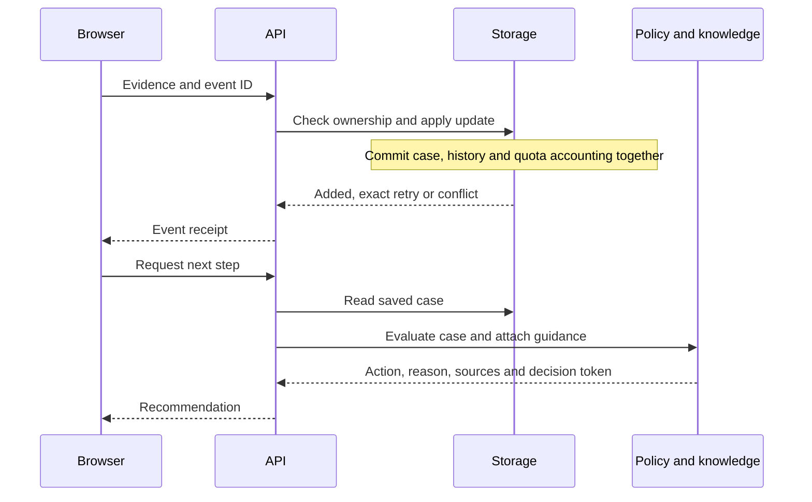

# Architecture

One FastAPI service serves the API and static frontend. SQLite is the local
default; the hosted service uses PostgreSQL. Both adapters expose the same
repository operations.

## Code layout

| Module | Responsibility |
| --- | --- |
| `models/case.py` | Case, observation, test-result and answer validation |
| `api/schemas.py` | HTTP request and response payloads |
| `api/main.py` | App setup, dependencies, middleware and route registration |
| `agent/rules.py` | Next-step policy; takes a case and returns a decision |
| `knowledge.py` | Source validation, action-to-card retrieval and decision fingerprints |
| `explanation_options.py`, `explanation_service.py`, `llm.py` | Build reviewed options, select the report/model path and validate provider responses |
| `db/` | Persistence, ownership, history, quotas and migrations |

Paths above are relative to `backend/app/`. Tests can pass an explicit database
to the app factory, inject a generator into the explanation service and replace
the provider's HTTP transport. The policy itself has no I/O.

## Recording evidence

An event ID identifies a submission. The same ID and payload is a retry; a
changed payload is rejected. A new ID records new evidence, even if its values
repeat an earlier observation. History stores accepted updates after creation
alongside the current case. It is not used to reconstruct state by replay.

SQLite uses write transactions. PostgreSQL takes a transaction-scoped advisory
lock for short mutations, including quota checks. Request counters use a
separate lock. Serializing writes keeps the accounting and retry rules simple,
but limits throughput. Connections close after each operation. Details and
rollback tests are documented in [PostgreSQL setup](postgres_setup.md).

## Preparing an explanation

The API first checks the submitted decision token against the current grounded
decision. Report steps return the existing action and reason directly. Other
steps acquire a process-local generation lock without queuing.

The server builds options containing the full action, optionally followed by
one attached guidance card. Each option must fit 80 words and 1,000 characters.
The configured provider returns an `option_id` under a constrained JSON Schema.
The adapter validates the response envelope, completion status, JSON and ID,
then retrieves the option text from memory. It rejects free-form advice, extra
fields, unknown IDs, refusals, tool calls and incomplete responses.

Before returning, the route reads the decision again and rejects a changed
recommendation. Provider errors leave the original recommendation available.
The [content review](explanation_review.md) explains the choice of this protocol.

The decision token hashes the recommendation and its knowledge revision. It is
a freshness check, not an access credential or a hash of the whole case. An
update that leaves the grounded decision unchanged can leave the token unchanged.

## Access and hosting

Browser-created cases belong to a session identified by a random token; the
database stores its hash. HTTPS uses a secure, HTTP-only, SameSite cookie.
Unauthorized case requests return 404. Mutation requests also pass origin and
JSON checks. See [case access](case_access.md).

Request-body limits, persistent request counters and storage quotas bound work
and stored data. Deletion checks ownership and a preview token before removing
the case, history and accounting in one transaction. See
[resource limits](resource_limits.md), [quotas](service_quotas.md) and
[deletion](case_deletion.md).

Render runs one worker. Increasing this would require shared inference capacity
because the generation lock is process-local. Startup checks the database schema;
migrations run explicitly. `/health` reports process liveness and does not probe
the database or model provider on each request.

## Open questions

- Does model-selected context help more than a fixed card-selection rule? The
  current evaluation checks wording preservation, not that comparison.
- At what load does the write lock become a bottleneck? No load benchmark has
  been run.
- How should access recovery work? Anonymous sessions currently expire after
  30 days; expiry removes access but does not delete the case.
